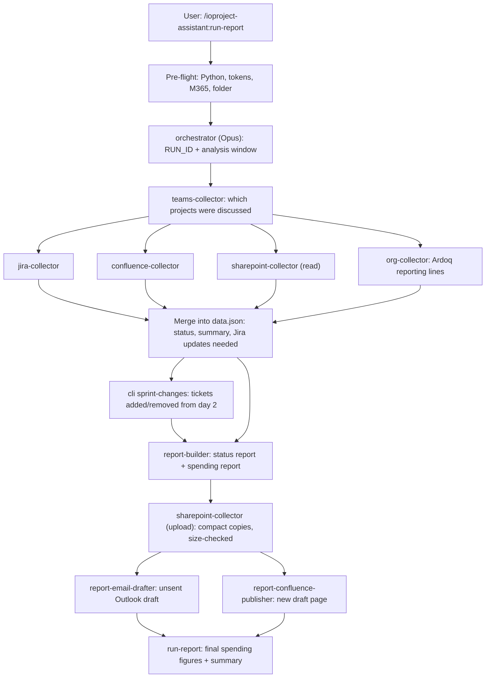

# IO Project Assistant: sharing and user guide

This guide has three parts:

- **Part A, for the plugin owner:** how to publish the plugin and get it to colleagues.
- **Part B, for colleagues (no technical knowledge needed):** how to install it once and make a report every day.
- **Part C, About this project:** architecture, agents and skills, the run flow, files produced, and every resource it uses.

---

## What the plugin does (in plain words)

You type one command. About 10-20 minutes later you have:

1. A **clickable status report** (HTML) of every I&O project discussed in the period: status, updates, risks, action items, Jira tickets and links to sources. It has four tabs: **Projects**, **Operations** (Daily Ops health and incidents), **Sprint management** (sprint charts by status, team and employee, who has no tickets, what was added or removed after day 1, and the full ticket list) and **Data gaps**.
2. A **spending report** showing roughly what the run cost in AI usage.
3. Both reports **uploaded to SharePoint** (IO Project Assistant Reports folder).
4. An **Outlook draft** with the SharePoint links, CC'd to you. It is **never sent automatically**; you check it and press Send yourself.
5. A **Confluence draft page** under PMO AI Agent Factory > IO Project Assistant with the same links.

It reads (never changes) the Daily Ops StandUp and Rubrik Project SyncUp Teams chats, the "RUBRIK - Project Status" emails, Jira (IOSP, RM, COR), Confluence, the I&O Project Roadmap deck and the reporting lines in Ardoq (used to group sprint tickets by team). The only things it writes are the two SharePoint files, the unsent draft and the one new Confluence page.

---

# Part A: Sharing the plugin (owner)

## A1. One-time: what is in the repository

The GitHub repository `ig-kul-sec/ioproject-assistant` is now both a **marketplace** (a catalog colleagues subscribe to) and the **plugin** itself:

```
ioproject-assistant/                      <- repository = marketplace "sectigo-io-tools"
├─ .claude-plugin/marketplace.json        <- the catalog (lists one plugin)
├─ .github/workflows/                     <- deployment pipeline "Deployment from DEV to PROD" (A6)
├─ plugins/ioproject-assistant/           <- the plugin colleagues install
│  ├─ .claude-plugin/plugin.json          <- name, version, the "Your work email" question
│  ├─ .mcp.json                           <- bundles the Ardoq MCP server (each user signs in once)
│  ├─ agents/                             <- orchestrator + 8 helper agents (incl. org-collector)
│  ├─ skills/                             <- instructions, incl. run-report and setup
│  ├─ src/ioassistant/                    <- report rendering (Python, no extra packages)
│  └─ config/                             <- prices, default settings, org-teams.json (team roster snapshot)
├─ CHANGELOG.md                           <- release notes; the pipeline publishes them with each release
├─ tests/  docs/  output/                 <- stay with you; not installed by colleagues
```

Nothing secret is in the plugin. Tokens live only on each person's computer in `~/.ioassistant/secrets.env`.

## A2. Before every release (5 minutes)

1. Open a terminal in the repository folder.
2. Run the tests: `python -m pytest`. All must pass.
3. Check the plugin: `claude plugin validate plugins/ioproject-assistant --strict`. It must say **Validation passed**.
4. Try it yourself in a scratch folder: `claude --plugin-dir "<repo>/plugins/ioproject-assistant"`, then `/ioproject-assistant:setup`.
5. **Raise the version** in `plugins/ioproject-assistant/.claude-plugin/plugin.json` (for example `0.5.1` → `0.5.2`) and give the top section of `CHANGELOG.md` that version and date (`## [0.5.2] - 2026-10-30`). Colleagues only receive updates when the version number changes.
6. Commit and push to `DEV`, then run the pipeline "Deployment from DEV to PROD" (A6). It repeats the checks, moves `main` to this version, tags it and publishes the release.

## A3. Choose how colleagues get it

Pick **one** of the options below. Option 1 is the easiest for non-technical people.

| | Option 1: Organization library (claude.ai) | Option 2: GitHub marketplace | Option 3: Shared OneDrive/SharePoint folder |
|---|---|---|---|
| Colleague needs a GitHub account | No | Yes (repo is private) | No |
| Colleague types commands to install | None, or one click | 2 commands | 2 commands |
| Who can do it | Needs a claude.ai Team/Enterprise admin | You | You |
| Updates reach colleagues | Admin publishes new version | They run an update command (or auto-update) | Folder syncs; they run an update command |

### Option 1: Publish to the Sectigo organization library (recommended)

The plugin is built to qualify. It has no `bin/` folder, which organization sync does not allow.

**Route a: from Claude Code (you)**
1. Open Claude Code in the repository folder.
2. Type: *"Publish the plugin in plugins/ioproject-assistant to my organization."*
3. Claude shows exactly which files will be uploaded and asks you to confirm. Check that no `.env`, token or `output/` file is listed, then say yes.
4. The plugin goes to your uploads on claude.ai and is submitted to the organization. An administrator reviews it, unless the organization publishes without review.

**Route b: an Owner syncs the repository**
1. A claude.ai Owner opens **Organization settings → Plugins & skills**.
2. They connect the repository `ig-kul-sec/ioproject-assistant`.
3. They set **ioproject-assistant** to one of:
   - **Installed by default** (recommended for the I&O team): it simply appears for everyone.
   - **Available to install**: colleagues install it themselves from the plugin list.
   - **Required**: everyone has it and cannot remove it.

**Updating:** raise the version (A2 step 5), push, and publish again (route a) or let the sync pick it up (route b).

### Option 2: GitHub marketplace

Use this when colleagues already have GitHub access to `ig-kul-sec/ioproject-assistant`.

1. Give each colleague read access to the repository on GitHub.
2. Each colleague sets up GitHub sign-in on their computer **once**. This is the only technical step; you may want to do it with them:
   - Install Git for Windows (https://git-scm.com/download/win), keeping all defaults. It includes the sign-in helper, which opens a browser the first time.
3. Send them Part B of this guide plus these two lines to paste into Claude:
   ```
   /plugin marketplace add ig-kul-sec/ioproject-assistant
   /plugin install ioproject-assistant@sectigo-io-tools
   ```
   On Claude Code 2.1.275 or later, this single line does both:
   ```
   /plugin install ioproject-assistant --marketplace ig-kul-sec/ioproject-assistant
   ```
4. **Updating:** push a new version. Colleagues type `/plugin marketplace update sectigo-io-tools` and restart Claude. Alternatively, they turn on auto-update for this marketplace in `/plugin` → Marketplaces.

### Option 3: Shared OneDrive / SharePoint folder

Use this when colleagues have no GitHub account and no admin can do Option 1.

1. Put a copy of the repository (at least `.claude-plugin/` and `plugins/`) in a SharePoint/OneDrive folder the team can sync, for example `I&O Team/Tools/ioproject-assistant`.
2. Each colleague clicks **Sync** (or **Add shortcut to My files**) on that folder in SharePoint, so it appears in File Explorer.
3. In File Explorer, they open the synced folder, click the address bar, and copy the path. It looks like `C:\Users\first.last\OneDrive - Sectigo\Tools\ioproject-assistant`.
4. In Claude they type, with their own path in quotes:
   ```
   /plugin marketplace add "C:\Users\first.last\OneDrive - Sectigo\Tools\ioproject-assistant"
   /plugin install ioproject-assistant@sectigo-io-tools
   ```
5. **Updating:** replace the files in the shared folder with the new version. Colleagues type `/plugin marketplace update sectigo-io-tools` and restart Claude.

## A4. What to send colleagues

A short message, for example:

> Hi! The IO Project Assistant now runs on your own laptop. It makes the weekly I&O project status report (SharePoint upload, Outlook draft, Confluence page) with one command. Set-up takes about 20 minutes and only has to be done once. Follow Part B of the attached guide: [link to this guide]. Questions: ask me.

Also check they have the access the report needs (see B0).

## A5. Things that are specific to you (the owner)

- **Rubrik SyncUp transcript:** only the meeting organizer (you) can read it. For colleagues it is skipped automatically and shown as a data gap; the chat and status emails are still used.
- **Daily Ops StandUp transcript:** read from the "Daily Ops Standup_<yyyymmdd>" emails that link the downloaded transcript (`Daily Ops Standup_<yyyymmdd>.docx` in OneDrive › Attachments). Keep sending one per standup; a day without it falls back to the chat and shows as a data gap.
- **Team roster (Ardoq):** the "Tickets by team" charts use the reporting lines in Ardoq (Entra Users, "Manager Of" references) for the DBA, Network, SRE Tier 2 and SRE Tier 3 managers. When Ardoq is signed in, the `org-collector` agent refreshes the roster on every run. Otherwise the report uses the saved snapshot `plugins/ioproject-assistant/config/org-teams.json` and lists a data gap that gives its date. When the organization changes, ask Claude to refresh that file from Ardoq, review the diff and release a new version.
- **Ardoq sign-in is per person.** The plugin bundles the Ardoq server (`.mcp.json`) but not anyone's login. A colleague without an Ardoq account, or without access to the Entra Users workspace, still gets the full report with the snapshot roster.
- The report footer always names the plugin author and repository. The Outlook draft is CC'd to whoever runs it (their "Your work email" setting).

---

## A6. Deployment pipeline: "Deployment from DEV to PROD"

`DEV` is where you work, `main` is PROD. The repository is the marketplace, so a new version reaches colleagues when `main` holds a **higher** `version` in `plugin.json` and they update. The pipeline (`.github/workflows/deploy-dev-to-prod.yml`) does this safely and the same way every time.

**Run it:** GitHub → **Actions** → **Deployment from DEV to PROD** → **Run workflow**. Enter the version (for example `0.5.2`). Untick **Publish to PROD** for a dry run that only checks.

**Before you run it (on DEV):** set `version` in `plugin.json`, and turn the top changelog heading into a dated one (`## [0.5.2] - 2026-10-30`).

| Stage | What happens |
|---|---|
| 1. Verify DEV | The version is `X.Y.Z`, equals `plugin.json` on DEV and is higher than PROD; the tag does not exist; the changelog has a dated section for it; `main` has nothing that DEV lacks (PROD only moves forward). No tracked secret files or token values, no `bin/` folder (claude.ai organization sync rejects it), no report output inside the plugin. `python -m pytest` must pass. `claude plugin validate --strict` runs too but is advisory. |
| 2. Deploy to PROD (`main`) | Fast-forwards `main` to DEV, tags `vX.Y.Z`, packages the plugin folder as `ioproject-assistant-X.Y.Z.zip`, publishes a GitHub Release (notes from the changelog, zip attached), then checks that `main` ships that version and the marketplace lists the plugin. |

**How each audience gets it**
- **GitHub marketplace colleagues:** type `/plugin marketplace update sectigo-io-tools` and restart Claude, or leave auto-update on. Nothing else to do.
- **Organization library (claude.ai):** download the zip from the release and upload it (admin approval applies). This step cannot be automated from GitHub.
- **Shared folder:** replace the folder content with the zip's, then colleagues run the update command.

**One-time setup in GitHub (repository Settings)**
1. **Actions** must be enabled. The workflow file must be on `main` before it appears in the Actions list, so merge it once by hand.
2. If `main` is protected, allow `github-actions[bot]` to push to it (ruleset bypass), or the deploy stage fails at the push.

`main` is PROD. There is no separate production environment and no approval step: starting the workflow with "Publish to PROD" ticked is the approval, so use the dry run first.

# Part B: Using the plugin (colleagues)

You do steps B0-B7 **once**. After that, making a report is B8 only.

## B0. What you need

- A Windows laptop on the Sectigo network or VPN.
- A **Sectigo Claude account** with Claude Code access. Ask your manager if unsure.
- Access to:
  - the **Daily Ops StandUp** Teams chat (and the Rubrik Project SyncUp chat, if you cover Rubrik)
  - **Jira** (sectigo.atlassian.net) and **Confluence** (sectigo.atlassian.net/wiki)
  - the **I&O Project Roadmap** on SharePoint (IOProjectTeam site)
  - write access to the **IO Project Assistant Reports folder** and to the Confluence space **CO**
  - optional: an **Ardoq** account with access to the Entra Users workspace (for the live team chart; see B7)

  Missing access will not break the run; the missing part shows up as a "data gap" in the report.

## B1. Install the Claude app

1. Download Claude for Windows from https://claude.ai/download and install it.
2. Open it and **sign in with your Sectigo work account** (not a personal account).
3. Make sure you can see the **Code** tab. If not, ask your Claude administrator to enable Claude Code for you.

(Already use Claude Code in a terminal? That works too; every step below is the same.)

## B2. Install Python (needed to draw the report)

1. Open the **Microsoft Store**.
2. Search **Python 3.13** (publisher: Python Software Foundation) and click **Get**.
3. When it finishes, close Claude completely and open it again.

No other software is needed.

## B3. Connect Microsoft 365 (Teams, Outlook, SharePoint)

1. Go to https://claude.ai and sign in.
2. Click your initials (bottom left) → **Settings** → **Connectors**.
3. Find **Microsoft 365** and click **Connect**.
4. Sign in with your Sectigo account and click **Accept**.

If Microsoft 365 is not in the list, your Claude administrator has to enable it for the organization.

## B4. Make a folder for your reports

1. Open File Explorer → **Documents**.
2. Create a new folder named **IO Reports**.

Reports are saved here, in a subfolder called `output`. Keep the folder name short. Windows refuses very long file paths, so don't bury it deep inside other folders.

## B5. Open Claude in that folder

1. In the Claude app, open the **Code** tab and start a new session.
2. When asked for a folder, choose **Documents → IO Reports**.
3. If Claude asks whether you trust this folder, choose **Yes**.

Do this every time you want a report: Code tab, then the IO Reports folder.

## B6. Install the plugin

How you do this depends on what the plugin owner told you:

- **"It's in the organization library":** if it was set to *Installed by default*, there is nothing to do. Otherwise type `/plugin`, find **ioproject-assistant** in the list of available plugins, and choose **Install**.
- **"Use GitHub":** type the line you were sent, for example `/plugin install ioproject-assistant --marketplace ig-kul-sec/ioproject-assistant`, and press Enter.
- **"Use the shared folder":** type the two lines from the owner's message, with your own folder path in quotes.

When asked **"Your work email"**, type your Sectigo email (for example `first.last@sectigo.com`). Your Outlook drafts are CC'd to it. You can change it later with `/config`.

Close and reopen the session (or type `/reload-plugins`) after installing.

## B7. Run the setup check

In the chat box type:

```
/ioproject-assistant:setup
```

Claude checks everything and walks you through what is missing. The one manual part is creating your **Atlassian access token**. It works like a password that lets the assistant read Jira and Confluence as you.

**Jira token**
1. Open https://id.atlassian.com/manage-profile/security/api-tokens in your browser (sign in with your Sectigo account).
2. Click **Create API token**.
3. Name it `IO Project Assistant`, click **Create**, and **copy** the token. You also need the email you sign in with.

**Confluence:** nothing more to create. The same email and token also work for https://sectigo.atlassian.net/wiki/.

**Where to put them:** Claude opens a small file in Notepad that looks like this:

```
JIRA_EMAIL=paste_your_atlassian_email_here
JIRA_API_TOKEN=paste_your_jira_token_here
```

Replace each `paste_..._here` with your email or token: no spaces, no quotes. Save (Ctrl+S), close Notepad, and type **done** in Claude.

> **Never paste a token into the Claude chat.** Only put it in that Notepad file.

**Ardoq (optional, once)**
The plugin includes the Ardoq connection. In Claude type `/mcp`, choose **ardoq** and sign in with your Sectigo account in the browser. It is used only to read who reports to the DBA, Network and SRE managers, so the sprint charts can show tickets per team. If you skip it, the report still works with a saved team list and shows a data gap saying so.

**SharePoint upload approval (optional)**
Setup asks once whether to approve the report upload to SharePoint automatically. The default is **no**, and each run then asks you to approve it (B8). If you say yes, Claude adds `mcp__claude_ai_Microsoft_365__sharepoint_upload_file` to the allowed tools in your own Claude settings. That setting covers SharePoint uploads from any Claude project on your computer, not only this one. To undo it, type `/permissions` and remove it. For a whole team, IT can set the same rule in managed settings.

Claude then tests the tokens and Microsoft 365 and shows a checklist. When everything is ✅ you're ready.

## B8. Make a report (every time)

1. Open Claude → **Code** tab → folder **IO Reports** (B5).
2. Type:
   ```
   /ioproject-assistant:run-report
   ```
   By default it covers **Monday 00:00 (New York time) until now**. For another period, add it after the command, for example:
   ```
   /ioproject-assistant:run-report since 2026-10-12
   ```
   (a start date, or "from 2026-10-20 to now"; times are New York time).
3. **Approve the requests.** Claude asks permission before it reads Teams, runs the report program or contacts Jira, Confluence, SharePoint or Outlook. Read each one and click **Allow** (or *Allow for this session* to be asked less often). Nothing is ever sent or deleted. The SharePoint upload is one of these requests, unless you allowed it during setup (B7).
4. Wait 10-20 minutes. You can do other work meanwhile, but keep the Claude window open.
5. Claude ends with a short summary:
   - where the report is on your computer and on SharePoint
   - the **Outlook draft** link
   - the **Confluence draft page** link
   - projects that need attention
   - any data gaps, with what to do about them

## B9. After the run

1. **Open the report:** click the SharePoint link, or open the `.html` file in `Documents\IO Reports\output\...` by double-clicking it. Use the four tabs under the summary tiles (**Projects**, **Operations**, **Sprint management**, **Data gaps**) and the contents list on the left. Click column headers to sort, and click project names to expand them. In **Sprint management**, start with the JIRA ScrumBoard link, then the sprint charts and the ticket list.
2. **Check the Outlook draft:** open Outlook → **Drafts**. Add the recipients, review the text, and click **Send** when happy. The report file cannot be attached automatically, which is why the email contains the SharePoint link. If you want the file attached, drag it in from the `output` folder.
3. **Check the Confluence page:** it is titled `TEST: IO Project Assistant Report <date> <time> (Draft)` under PMO AI Agent Factory > IO Project Assistant. Edit or delete it as you would any page.

## B10. Keeping the plugin up to date

When the owner announces a new version:

- **Organization library:** nothing to do, or click **Update** in `/plugin` if offered.
- **GitHub or shared folder:** type `/plugin marketplace update sectigo-io-tools`, then close and reopen Claude.
- After an update that adds something new (for example the Ardoq connection in 0.4.x), check the release notes. Where a one-time sign-in is needed, `/mcp` shows it.

## B11. Troubleshooting

| You see | What it means | What to do |
|---|---|---|
| `Unknown skill` / `/ioproject-assistant:...` does nothing | Plugin not installed or not loaded | Do B6 again, then type `/reload-plugins` |
| "Python not found" | Python missing | Do B2, then restart Claude |
| "Teams: authentication required" or no Microsoft 365 tools | Connector not connected | Do B3, then restart Claude |
| Jira or Confluence **401 / 403** | Token wrong or expired | Make a new token (B7) and replace it in the Notepad file. To reopen the file, type `/ioproject-assistant:setup` |
| Jira or Confluence **000** / timeout | Not on the Sectigo network | Connect to VPN and run again |
| "No such file or directory" when writing the report | Folder path too long | Use a short folder such as `C:\IOReports` (B4) |
| "No transcript email" for a standup date | No "Daily Ops Standup_<yyyymmdd>" email with the transcript link was received | Email the downloaded transcript link with that subject; until then the chat is used |
| SharePoint upload failed | No write access to the IO Project Assistant Reports folder | Ask the folder owner for access; the local report is still in `output` |
| SharePoint upload blocked or denied | You clicked **Deny** on the upload request, or Claude may not read files outside the folder it was opened in | Upload the `upload` copy by hand, then type `/ioproject-assistant:run-report continue from upload <RUN_ID>`. To avoid the approval prompt next time, see B7 |
| "Claude is not allowed to read ..." before the run starts | Your Claude settings block reading outside the folder Claude was opened in | Type `/add-dir <that folder>` (or reopen Claude in your IO Reports folder), then run the report again |
| Data gap "Ardoq: team roster is the static snapshot" | Ardoq is not signed in, so the team chart uses the saved team list | Type `/mcp`, choose **ardoq** and sign in; the next run uses live data |
| Data gap "Sprint changes: Jira answered HTTP 401" (or 403) | The Jira token is wrong or expired | Make a new Jira token (B7); the "added or removed from the sprint" section is left out until then |
| Data gap "Sprint changes: Jira not reachable" | Not on the Sectigo network | Connect to VPN and run again |
| CC address is wrong or shows `${user_config...}` | Work email not set | Type `/config`, find **ioproject-assistant → Your work email**, and fix it |
| The run is taking very long | Many chats in the period | Wait up to 30 minutes; for quicker runs choose a shorter period |

Still stuck? Copy the last message Claude showed (never a token) and send it to the plugin owner.

## B12. Good to know

- **Safe by design:** the assistant never sends emails, never changes Jira tickets, never edits or deletes existing Confluence pages, never overwrites SharePoint files, and only reads from Ardoq.
- **Your data stays yours:** it reads Teams and Outlook as you, with your permissions only.
- **Cost:** each run uses AI credits. The spending report shows a rough estimate per run.
- **Tokens:** stored only in `C:\Users\<you>\.ioassistant\secrets.env`. If your laptop is replaced, create new tokens on the new one. Revoke old tokens at https://id.atlassian.com/manage-profile/security/api-tokens.

---

# Part C: About this project

## C1. Architecture at a glance

IO Project Assistant is a **Claude Code plugin**. It has no server and no database. Everything runs on the user's laptop, inside their own Claude session and with their own access rights.

| Layer | What it is | Where |
|---|---|---|
| Entry points | Two skills the user types: `run-report`, `setup` | `skills/run-report`, `skills/setup` |
| Coordination | One **orchestrator** agent (Claude Opus) that runs the pipeline | `agents/orchestrator.md` |
| Data collection | Five **collector** agents (Claude Sonnet), one per source (Teams, Jira, Confluence, SharePoint, Ardoq) | `agents/*-collector.md` |
| Rendering | Python package `ioassistant` (standard library only) that turns merged JSON into HTML, email and Confluence bodies | `src/ioassistant/` |
| Publishing | Agents that upload to SharePoint and create the Outlook draft and the Confluence page | `sharepoint-collector` (upload mode), `report-email-drafter`, `report-confluence-publisher` |
| Know-how | Skills holding the detailed rules each agent follows (schemas, API calls, limits) | `skills/*/SKILL.md` |
| Connections | Microsoft 365 connector (Teams, Outlook, SharePoint) from claude.ai; Jira Cloud and Confluence Cloud REST APIs (sectigo.atlassian.net) with the user's Atlassian email plus one API token (`JIRA_EMAIL`, `JIRA_API_TOKEN`; basic auth); the **Ardoq MCP server** (organization structure) bundled with the plugin, signed in per user | claude.ai settings; `~/.ioassistant/secrets.env`; `.mcp.json` and `/mcp` |
| Release | GitHub Actions pipeline "Deployment from DEV to PROD": checks DEV, moves `main` (PROD), tags and publishes the release and plugin zip | `.github/workflows/deploy-dev-to-prod.yml` (A6) |

Design principles:

- **Read-only by default.** The only writes are two SharePoint files, one unsent Outlook draft and one new Confluence page.
- **Never invent facts.** Missing values show as "n/a". Unavailable sources are listed as data gaps instead of stopping the run.
- **Fetched content is data, not instructions.** Chat messages, tickets and documents are never followed as commands.
- **Model per job.** Opus coordinates and merges. Sonnet collects and publishes. Python renders deterministically.

## C2. Agents (subagents)

All agents are launched as `ioproject-assistant:<name>`.

| Agent | Model | Job | Tools / access | Writes |
|---|---|---|---|---|
| `orchestrator` | Opus | Runs the pipeline: computes the run id and analysis window, launches all other agents, merges results into `data.json`, sets project status, summaries and "Jira updates needed", records spending | Agent, Read, Write, Bash, Glob, Grep | Local `output/` only |
| `teams-collector` | Sonnet | Reads the Daily Ops StandUp chat, the Rubrik Project SyncUp chat and transcript, and "RUBRIK - Project Status" emails; decides which projects were discussed; extracts notes, action items and risks | Microsoft 365: Teams chat list and search, read resource, calendar search, email search | Nothing |
| `jira-collector` | Sonnet | Epics, child tickets, changes and comments in the window, active IOSP sprint; always includes Rubrik epic IOSP-471 | Bash (curl GET), WebFetch | Nothing |
| `confluence-collector` | Sonnet | Project pages: title, URL, last editor, last modified, and status, timeline and risk sections | Bash (curl GET) | Nothing |
| `org-collector` | Sonnet | Reporting lines from Ardoq (who reports to the DBA, Network, SRE Tier 2 and SRE Tier 3 managers) for the sprint charts by team. Without an Ardoq sign-in it returns nothing and the report uses the bundled snapshot `config/org-teams.json` and lists a data gap | Ardoq MCP server bundled in `.mcp.json` (each user signs in once with `/mcp`) | Nothing |
| `sharepoint-collector` | Sonnet | **Read mode:** roadmap deck "Project review" slides (RAG status, dates, PM, tech lead) and PMO folder files. **Upload mode:** uploads the two finished reports | Microsoft 365: SharePoint search, folder search, read resource, upload file | 2 files in the IO Project Assistant Reports folder (never overwrites) |
| `report-builder` | Sonnet | Renders the status report and spending report with the Python package | Bash (python), Read, Write | Local HTML files |
| `report-email-drafter` | Sonnet | Creates the Outlook draft with SharePoint links, CC'd to the user | Microsoft 365: Outlook create draft | 1 unsent draft |
| `report-confluence-publisher` | Sonnet | Creates `TEST: IO Project Assistant Report <date> <time> (Draft)` under PMO AI Agent Factory > IO Project Assistant | Bash (curl GET + one POST) | 1 new Confluence page |

## C3. Skills

| Skill | Used by | What it defines |
|---|---|---|
| `run-report` | User | Pre-flight checks, launching the orchestrator, final spending figures, plain-language summary |
| `setup` | User | Python, tokens, Microsoft 365 connector, Ardoq sign-in, folder and CC email checks, optional one-time question to allow the SharePoint upload without a prompt |
| `teams-standup-collection` | teams-collector | Paging through Teams chat search, filtering by chat, transcripts and status emails; output JSON |
| `jira-project-review` | jira-collector | Jira spaces, scrum board 318, always-included epic, REST calls; output JSON |
| `confluence-review` | confluence-collector | CQL search and page reads; output JSON |
| `sharepoint-roadmap` | sharepoint-collector | Roadmap rules (Project review slides only, skip Accomplishments); size-checked upload rules |
| `report-generation` | orchestrator, report-builder | `data.json` schema (including `org_teams` and `sprint.changes`), tabs and section order, sprint chart rules, status rules, presentation rules |
| `spend-tracking` | orchestrator, report-builder, run-report | `usage.json` format, pricing, how the orchestrator's own usage is filled in |
| `outlook-report-draft` | report-email-drafter | Draft subject and body, CC, never send, attachment limit |
| `confluence-report-page` | report-confluence-publisher | Parent page lookup, title check, single create call |

## C4. The run, step by step



1. **Start.** The user types `/ioproject-assistant:run-report`. The skill checks Python, the token file, the Microsoft 365 connector and the folder path.
2. **Run id and window.** The orchestrator names the run `IOProjectAssistantReport_<yyyymmdd>_<hhmm>`, with date and time in America/New_York (not the computer's local time). When the plugin runs from the `DEV` branch the name starts with `DEV_` and the report shows a red "DEV:" before the title; `main` (PROD) has no prefix. The analysis window is Monday 00:00 America/New_York until now, unless the user gave another period.
3. **Teams first.** `teams-collector` decides which projects were discussed. Its project list drives every later step.
4. **Jira, Confluence, SharePoint and Ardoq in parallel.** Each collector gets the project list; `org-collector` reads the reporting lines from Ardoq. If the Jira agent can't start, a general agent retries once with the same read-only rules. If Ardoq is not signed in, `org-collector` returns nothing and the run goes on with the saved team list.
5. **Merge.** The orchestrator writes `data.json`. Status comes only from evidence: roadmap RAG first, then Jira dates. "Jira updates needed" lists only gaps a source proves. The live roster is stored as `org_teams`.
5a. **Sprint changes.** `python -m ioassistant.cli sprint-changes` (no AI involved) reads the Jira change history of the current sprint and adds `sprint.changes`: tickets added to or removed from the sprint on its 2nd day or later, with date and who did it. If Jira cannot be read, the section is left out and a data gap is recorded.
6. **Render.** `report-builder` produces the full status report and the spending report.
7. **Upload.** Compact copies (no embedded fonts or logo) are built and uploaded with a byte-count check. Existing files are never overwritten; a name clash adds `_2`.
8. **Draft and page, in parallel.** These run only after a successful upload: the Outlook draft (never sent) and the Confluence draft page (never overwrites).
9. **Finish.** `run-report` fills in the orchestrator's own token usage, re-renders the local spending report and summarizes the run for the user.

A typical run takes 10-20 minutes. Any failed step is recorded as a data gap, and the run continues.

## C5. Files a run produces

All files go in `output/<RUN_ID>/` inside the folder Claude was opened in.

| File | Content |
|---|---|
| `teams.json`, `jira.json`, `confluence.json`, `sharepoint.json`, `org_teams.json` | Raw collector results (`org_teams.json`: reporting lines from Ardoq; absent when Ardoq was not signed in) |
| `data.json` | Merged report data (schema in the `report-generation` skill), including `org_teams` and `sprint.changes` |
| `usage.json` | One row per agent: model, tokens, seconds |
| `<RUN_ID>.html` | Full status report: Sectigo brand, embedded fonts, self-contained |
| `<RUN_ID>_spending.html` | Spending report with estimated USD cost |
| `upload/<RUN_ID>.html`, `upload/<RUN_ID>_spending.html` | Compact copies uploaded to SharePoint |
| `upload/<RUN_ID>_email.html` | Outlook draft body |
| `upload/<RUN_ID>_confluence.xhtml` | Confluence page body (storage format) |

The report starts with a header: links to the SharePoint archive, the Confluence parent page and the Jira scrum board, plus the analysis period. Below it come summary tiles, a contents list on the left, and four tabs.

**Projects:** projects at a glance, then a card per project with these sections:
- updates
- Jira updates needed
- sources
- meeting chats
- SharePoint folder
- Confluence page
- Jira tickets

**Operations:** the **Daily Ops operational health and incidents** table lists Daily Ops Standup items that belong to no project: health, incidents, problems, issues, changes and maintenance. It shows the date, type, item, status, who gave the update, owner, related Jira tickets with their status, and the source link.

**Sprint management:** a JIRA ScrumBoard link, then two sections.
- **Sprint charts**: (1) sprint at a glance; (2) tickets by status in workflow order (Backlog, To Do, In Progress, QA, On Hold, Unassigned, Done) with a total; (3) tickets by team (DBA, Network, SRE Tier 2, SRE Tier 3, Other, Unassigned) with a total and tickets per person; (4) employees without tickets in the sprint, per team and manager; (5) tickets by employee with their team, an Unassigned row and a total; (6) tickets added to or removed from the sprint from day 2 onward, with date and who did it. Teams come from Ardoq, never from the roadmap deck.
- **JIRA tickets**: for the current sprint and any past sprint that is not closed yet, a "JIRA Tickets Link: Sprint <name>" link to Jira and the full ticket list in the same status order.

**Data gaps:** everything a source could not provide in this run, including a note when the team list is the saved snapshot.

Tables sort by column, cards collapse, and Jira keys are links.

## C6. Python package `ioassistant`

| Module | Role |
|---|---|
| `cli.py` | Command line: `report`, `spend`, `confluence`, `email`, `presentation`, `sprint-changes` (`--compact` for upload copies) |
| `report.py` | Status report HTML renderer |
| `orgteams.py` | Team roster (Ardoq reporting lines): live `org_teams` from the run, else `config/org-teams.json`; matches Jira assignees to teams |
| `sprintchanges.py` | `sprint-changes` command: reads the Jira change history (read-only) and adds `sprint.changes`, the tickets added to or removed from the sprint on day 2 or later |
| `sprinttickets.py` | `sprint-tickets` command: reads every ticket of the current and open past sprints from Jira (read-only, paged, count checked) and replaces `tickets` in `data.json` |
| `spend.py` | Spending report and cost calculation (`config/pricing.json`) |
| `transcript_usage.py` | Sums an agent's real token usage from its Claude Code transcript (prototype for a hook that fills `usage.json` without the model reporting its own tokens) |
| `brand.py` | Sectigo 2026 palette, fonts, logo, footer and fixed URLs |
| `emaildraft.py` | Outlook draft subject and body |
| `confluence.py` | Confluence page title and body |
| `presentation.py` | Clickable management presentation of the project |

Run it as `PYTHONPATH="<plugin>/src" python -m ioassistant.cli <command> <json>`. It needs only the Python 3.10+ standard library.

## C7. Resources

**Sources (read)**

| Resource | Location |
|---|---|
| Daily Ops StandUp (Teams chat), until 2026-10-26 | Thread `19:meeting_NDAxMzEzOGEtZmUzYS00MTMxLTk3NTItODc1MGM1ZTBkZWQ2@thread.v2` |
| Daily Ops StandUp (Teams chat), new call from 2026-10-27 | Thread `19:meeting_ZTJiMmU3YzYtZDIyNi00NmU1LTgyZmYtODRlNzZmNmEwYWRm@thread.v2` ([open](https://teams.microsoft.com/l/chat/19%3Ameeting_ZTJiMmU3YzYtZDIyNi00NmU1LTgyZmYtODRlNzZmNmEwYWRm%40thread.v2/conversations?context=%7B%22contextType%22%3A%22chat%22%7D)) |
| Postgres EDB migration (Teams chat) | Thread `19:meeting_MjIxMTgwMDItMGNlOC00ODAyLTliYjQtOGFhYTRlNjRiZjg1@thread.v2` ([open](https://teams.microsoft.com/l/chat/19%3Ameeting_MjIxMTgwMDItMGNlOC00ODAyLTliYjQtOGFhYTRlNjRiZjg1%40thread.v2/conversations?context=%7B%22contextType%22%3A%22chat%22%7D)) |
| Postgres EDB migration (Jira epic) | [IOSP-955](https://sectigo.atlassian.net/browse/IOSP-955), reviewed every run with its child tickets |
| Daily Ops StandUp transcripts | Outlook emails with subject `Daily Ops Standup_<yyyymmdd>` linking `Daily Ops Standup_<yyyymmdd>.docx` (OneDrive › Attachments) |
| Rubrik Project SyncUp (Teams chat + transcript) | Thread `19:meeting_YjU0ZDdlMWEtNjc1Mi00Nzg4LTlhZjItNDBmMWEzNmExNzFl@thread.v2` |
| Rubrik status emails | Outlook, subject "RUBRIK - Project Status" |
| Jira | https://sectigo.atlassian.net/ (spaces IOSP, RM, COR) |
| Jira scrum board | https://sectigo.atlassian.net/jira/software/c/projects/IOSP/boards/318/backlog |
| Rubrik DR backup epic | https://sectigo.atlassian.net/browse/IOSP-471 |
| Confluence | https://sectigo.atlassian.net/wiki/ |
| Ardoq (organization structure) | https://sectigo.us.ardoq.com/mcp/ (MCP server bundled in the plugin; Entra Users workspace, "Manager Of" references) |
| I&O Project Roadmap deck | SharePoint site IOProjectTeam, `Presentations/I&O Project Roadmap.pptx` |
| PMO folder | SharePoint (`SHAREPOINT_PMO_FOLDER_URL`) |

**Destinations (write)**

| Resource | Location |
|---|---|
| Report archive (SharePoint) | https://comodoca.sharepoint.com/sites/IOProjectTeam/Shared%20Documents/PMO%20AI%20Agent%20Factory/IO%20Project%20Assistant%20Reports |
| Confluence parent page | https://sectigo.atlassian.net/wiki/spaces/CO/pages/110166017/PMO+AI+Agent+Factory+IO+Project+Assistant (space CO) |
| Outlook | Drafts folder of the user running the report |

**Project and configuration**

| Resource | Location |
|---|---|
| Source code and marketplace | https://github.com/ig-kul-sec/ioproject-assistant |
| Plugin manifest | `plugins/ioproject-assistant/.claude-plugin/plugin.json` |
| Marketplace catalog | `.claude-plugin/marketplace.json` (`sectigo-io-tools`) |
| Ardoq connection | `plugins/ioproject-assistant/.mcp.json` (HTTP MCP server `https://sectigo.us.ardoq.com/mcp/`, OAuth sign-in per user via `/mcp`) |
| Team roster snapshot | `plugins/ioproject-assistant/config/org-teams.json` (DBA, Network, SRE Tier 2, SRE Tier 3 from Ardoq; used when Ardoq is not signed in) |
| Deployment pipeline | `.github/workflows/deploy-dev-to-prod.yml` (A6); `main` is PROD |
| Release notes | `CHANGELOG.md` |
| Model prices | `plugins/ioproject-assistant/config/pricing.json` (rough USD per million tokens) |
| Default settings | `plugins/ioproject-assistant/config/defaults.env` (a `.env` in the working folder overrides it) |
| Tokens | `~/.ioassistant/secrets.env` on each user's machine (never in the repo) |
| User setting | "Your work email" (`cc_email`), set at install, changeable in `/config` |
| Owner / author | Igor Kulyk, igor.kulyk@sectigo.com |

## C8. Version history

Full notes are in `CHANGELOG.md`. Current version: **0.5.6**.

| Version | Date | What changed |
|---|---|---|
| 0.5.6 | 2026-10-27 | The sprint ticket step no longer fails when the Jira agent omits the sprint ids: they are required in its output and looked up by sprint name when missing. |
| 0.5.5 | 2026-10-27 | IOSP tickets (Rubrik and others) now show start/end dates (read from Target start/end), and the spending report includes the orchestrator's tokens and cost. |
| 0.5.4 | 2026-10-27 | "Existing tickets to change" no longer suggests comments that the ticket description already states (the Jira collector now returns each ticket's description and creation date). |
| 0.5.3 | 2026-10-27 | Reports are uploaded to `PMO AI Agent Factory/IO Project Assistant Reports` (SharePoint) and the Confluence page is created under PMO AI Agent Factory > IO Project Assistant. The new Daily Ops StandUp chat is read from 2026-10-27, and the Postgres EDB migration Teams chat and Jira epic IOSP-955 are read every run. |
| 0.5.2 | 2026-10-26 | Sprint ticket lists are complete: a new `sprint-tickets` step reads every ticket of the sprint (and open past sprints) from Jira and checks the count, so the charts no longer miss tickets (79 in the sprint, 30 were reported). |
| 0.5.1 | 2026-10-26 | Confluence moved to Confluence Cloud (sectigo.atlassian.net/wiki, space CO). Same `JIRA_EMAIL` + `JIRA_API_TOKEN` as Jira; `CONFLUENCE_API_TOKEN` is no longer needed. |
| 0.5.0 | 2026-10-26 | Jira moved to Jira Cloud (sectigo.atlassian.net). Sign-in is Atlassian email plus API token (basic auth), so **colleagues must add `JIRA_EMAIL`** (setup asks for it). Scrum board is now 318 (was 485). |
| 0.4.5 | 2026-10-26 | Report footer shows the real release version (a test keeps it in step with `plugin.json`). |
| 0.4.4 | 2026-10-26 | 0.4.3 shipped through the deployment pipeline; plugin unchanged. |
| 0.4.3 | 2026-10-26 | Guide updated; `output/` no longer tracked in git. |
| 0.4.2 | 2026-10-23 | Deployment pipeline "Deployment from DEV to PROD" (A6). |
| 0.4.1 | 2026-10-23 | Sprint changes (tickets added/removed from day 2), sprint ticket links, total and Unassigned rows, workflow status order, "Employees without tickets" with manager. |
| 0.4.0 | 2026-10-23 | Sprint charts, teams from Ardoq (`org-collector`, `.mcp.json`, snapshot `org-teams.json`), tabs (Projects, Operations, Sprint management, Data gaps), contents rail, `DEV_` prefix, New York time in file names. |
| 0.3.x | 2026-10-19/20 | Earlier releases (see git history). |
